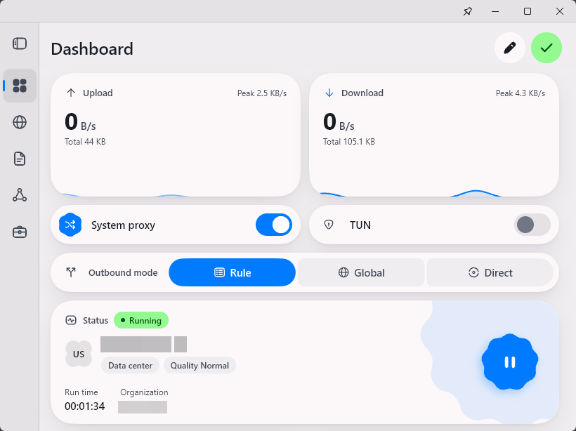

# FlClash_PE

[English](README.md)

PE，意思是 **Personal Edition（个人版）**。  
本Fork基于上游项目，根据个人偏好对界面和功能进行定制与调整。

## 已做出的修改

- **托盘图标：** ~~上游项目的托盘图标尺寸较小，且不同状态间的差异也不够明显。~~ 上游项目在v0.9.2将托盘图标恢复为了早期版本样式。 因此，将其重新设计为更接近早期版本(v0.8.7*之前)的风格，并且加入适配系统主题效果。
- **仪表盘：** 现在可以在任意窗口尺寸下编辑移除仪表盘组件。通过移除和调整位置，仪表盘能恢复成类似前期版本(v0.8.98及之前)的风格布局和交互习惯，对小尺寸的窗口大小更加友好。
- **侧边栏：** 略微增加收缩状态下侧边栏中菜单图标填充大小。之前的菜单图标不够明显，展示和点击区域有点小。修改后对小尺寸的窗口大小更加友好。
- **i18n：** 韩语法语和西班牙语支持已被移除。个人觉得这些区域几乎没有本软件的使用场景，过多的语言支持并没有必要。

## 效果预览

以下截图展示了仪表盘与侧边栏调整后的效果。

  <picture>
    <source media="(prefers-color-scheme: dark)" srcset="snapshots/preview.png">
    
  </picture>

## ToDo

- [ ] **优化配置页面布局**

  新版本(v0.9.1及之后)中部分实用信息被移除。计划重新调整配置页面布局，使用新版的样式和交互，恢复部分前期版本信息展示。  
  优先级中，现在的界面也很好看。

- [ ] **优化启动按钮**

  新版(v0.9.1及之后)仪表盘中的启动按钮不够明显，点击操作也不够方便。不过，上游作者的设计考虑也是合理的：随着 UI 的演进，采用 MD 风格的悬浮操作按钮（Floating Action Button）已经不太符合新版界面的整体设计语言。  
  优先级中，目前仍在考虑如何兼顾操作体验与设计一致性。

- [ ] **优化测试与跳转按钮**

  与启动按钮类似，新版本(v0.9.1及之后)中代理页的测试和跳转按钮在操作便利性方面有所下降。  
  优先级中，目前仍在探索能够改善使用体验，同时又不破坏整体设计风格的方案。

- [ ] **恢复 Material Design 风格**

  个人更喜欢 Material You 设计风格。不过，恢复这一风格需要大量开发工作，并且随着上游项目持续更新，后续兼容和维护的成本会不断上升。  
  因此，这项工作只能列为低优先级。

## 其他说明

- **个人使用：** 本 Fork 主要体现个人偏好。欢迎提出功能需求和改进建议，但并不保证所有建议都会被采纳或实现。
- **支持上游项目：** 本项目的实现建立在上游作者及贡献者的工作之上，请支持上游项目及其开发者。对于 FlClash_PE 特有的问题或修改所引入的缺陷，请优先在本项目反馈，避免将分叉版本的问题误归于上游项目或打扰上游维护者。
- **免责声明：** 本项目不提供付费服务、代理节点或其他商业服务，也不以协助实施违法活动为目的。使用者应自行了解并遵守所在地适用的法律法规，并对自身的使用行为负责。
- **更新频率：** 为控制维护成本，部分影响较小或非必要的上游版本可能会被跳过。其他更新则可能在上游发布新版本后不久推出。
- **平台支持：** 考虑日常使用的平台以及本Fork修改的内容，目前仅维护 Windows 和 Linux 版本。新版(v0.9.1及之后)风格已经比较符合mac OS整体设计语言，所以暂无计划。至于 Android 版本，是否提供支持取决于后续是否决定使用不同的应用包名和签名密钥重新构建应用；否则，该版本与原版同时安装时会发生冲突。